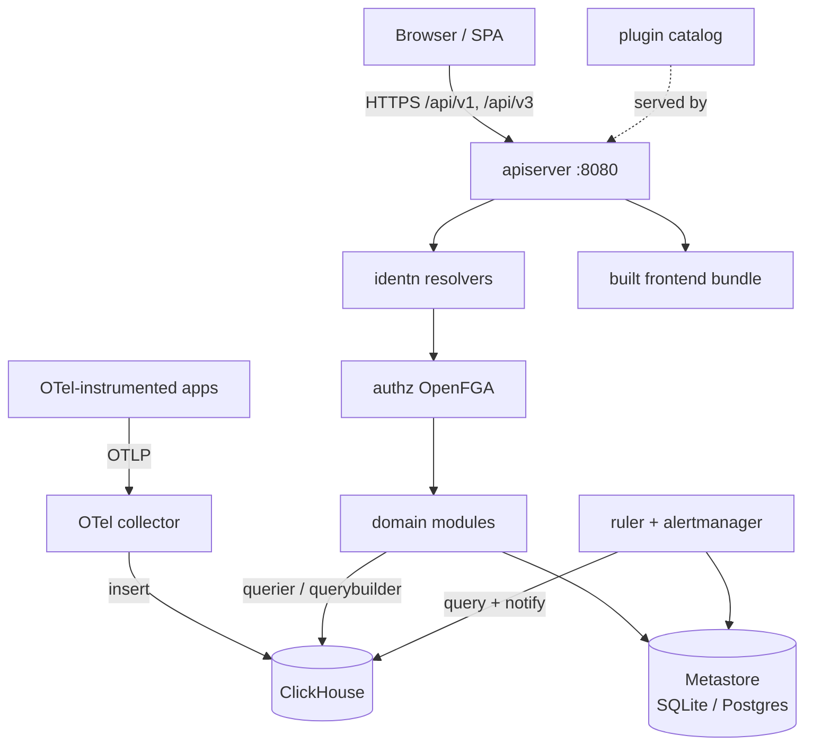

# SigNoz — Architecture

## Overview

SigNoz is an observability platform: it stores OpenTelemetry traces, logs, and
metrics and serves a query/alerting/dashboard product on top of them. This fork
is MIT-only — the community server binary in `cmd/community` is the whole
backend, with no license checks, no hosted-service dependency, and no enterprise
tree.

The backend is a Go modular monolith. `cmd/community/main.go` registers Cobra
commands (`server`, `generate`, `metastore`) and `server.go` constructs every
provider from configuration before handing control to the apiserver. Two
storage planes are kept strictly apart: **metadata** (organizations, users,
dashboards, alerts, ingestion keys) in SQLite by default or Postgres, and
**telemetry** in ClickHouse. The React frontend is built separately and served
by the same binary through the `web` router provider.

## System diagram

## Core components

| Component | Purpose |
|-----------|---------|
| `apiserver` | HTTP entry point at `0.0.0.0:8080`; per-domain route registration in `signozapiserver/` |
| `identn` | Resolves who is calling: tokenizer (JWT/opaque), API key, impersonation |
| `authz` | OpenFGA-based permission checks behind the `AuthZ` middleware |
| `modules/*` | 29 domain modules (dashboards, alerts, users, service accounts, ingestion keys, tags, …) |
| `sqlstore` + `sqlmigration` | Relational metastore and its ordered migrations (135 files, 000–135) |
| `telemetrystore` + `telemetryschema` | ClickHouse access and per-signal schemas |
| `querybuilder`/`queryparser`/`statementbuilder` | Translate v5 query envelopes and filter grammars into ClickHouse SQL |
| `ruler` + `alertmanager` | Rule evaluation, alert state, notification fan-out |
| `plugins` | Allowlisted Web Component catalog for dashboard panels |
| `gateway` | Ingestion-key CRUD and limits (`sqlgateway`) |

→ *Components ↔ directories: see [PROJ-LAYOUT.md](PROJ-LAYOUT.md) and [layout/pkg.md](layout/pkg.md)*

## Request flow

1. **Identity.** Every request passes the `identn` middleware, which consults
   enabled resolvers (tokenizer, API key, impersonation) and attaches claims to
   the context. Cross-org identity is rejected with `::IDENTITY-CROSS-ORG::`.
2. **Authorization.** `AuthZ` middleware resolves the caller's org and checks
   relationship tuples through the OpenFGA provider; denials surface as
   `::AUTHZ-DENIED::`.
3. **Domain work.** The route handler delegates to a module, which reads or
   writes the metastore through `sqlstore`.
4. **Telemetry reads.** Query endpoints go through `querier` → `querybuilder` →
   `statementbuilder` and execute against ClickHouse.
5. **Audit.** Mutating paths emit audit events through `auditor`.

→ *See [PROJ-SCHEMA.md](PROJ-SCHEMA.md) for both storage planes*

## Configuration

A single YAML config (repeatable `--config`, later files win) with sections for
every subsystem: `global`, `sqlstore`, `telemetrystore`, `apiserver`,
`prometheus`, `alertmanager`, `authz`, `identn`, `gateway`, `plugins`, and more.
`conf/example.yaml` is the annotated reference for the full set.

→ *See [PROJ-LAYOUT.md](PROJ-LAYOUT.md) for setup files*

## Deployment

- One container image: Go binary + built frontend. `noizu-image` workflow builds
  and publishes on pushes to `develop` and tags, to GHCR plus optional ops and
  Docker Hub registries (each skipped when credentials are absent).
- Schema is applied at boot by the migrator; there is no separate migration job.
- Telemetry ingestion is performed by the OTel collector, which writes to
  ClickHouse directly rather than through this backend.

## Key decisions

- **MIT-only fork** — enterprise code paths and licensing were removed; the
  `licensing` provider is a noop and the ingestion-key gateway was reimplemented
  clean-room against the metastore.
- **Provider/factory pattern** — every subsystem is a named provider chosen by
  config, which is what lets noop variants (web, pprof, zeus, subscription,
  licensing) drop into the community build.
- **Split storage planes** — relational metadata and columnar telemetry have
  different lifecycles, scaling, and failure modes; keeping them separate lets
  SQLite serve small installs while ClickHouse carries signal volume.
- **Generated API contract** — `cmd/openapi.go` emits `docs/api/openapi.yml`,
  which both gates backend CI and generates the frontend client via orval, so
  the wire contract cannot drift silently.
- **Allowlisted plugins** — dashboard panels reference a `pluginId` from a
  registry; arbitrary script URLs in panel JSON are never honored.
