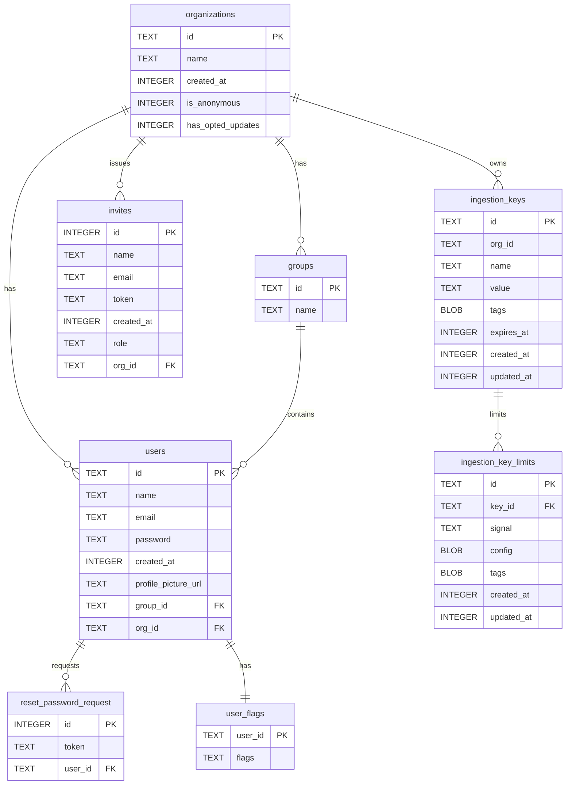
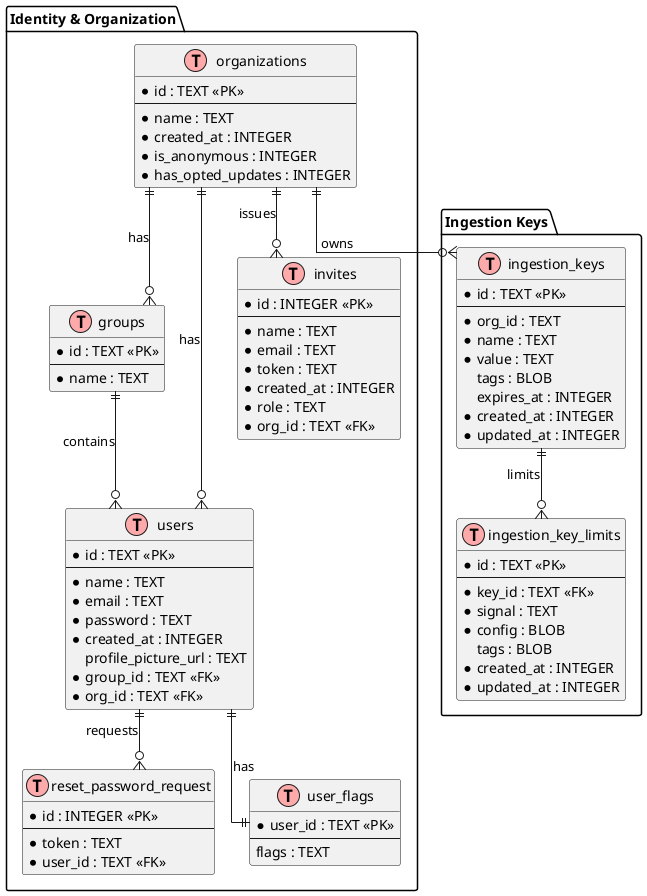

# SigNoz — Data Schema

## Scope

SigNoz has **two persistence planes** and no Liquibase: schema is owned by Go
migrations in `pkg/sqlmigration` executed by `sqlmigrator` at boot.

| Plane | Store | Schema source |
|-------|-------|---------------|
| Metadata (struct data) | SQLite (default) or Postgres | `pkg/sqlmigration/000–135` (bun migrations) |
| Telemetry (signals) | ClickHouse | `pkg/telemetryschema/*` + collector DDL; queried by `querybuilder` |

Metadata tables are declared twice in effect: older migrations build bun
`CreateTable` models inline, newer ones build `sqlschema.Table` values so the
same migration emits dialect-correct DDL for SQLite and Postgres
(`sqlschema/operator.go`). Types below are the SQLite rendering; Postgres gets
the equivalent (`TEXT`, `BIGINT`, `TIMESTAMPTZ`).

## Metadata ERD



### PlantUML



## Core tables

### organizations

| Column | Type | Nullable | Default | Description |
|--------|------|----------|---------|-------------|
| id | TEXT | No | — | Primary key (UUID text) |
| name | TEXT | No | — | Display name |
| created_at | INTEGER | No | — | Unix seconds |
| is_anonymous | INTEGER | No | 0 | Anonymous org flag |
| has_opted_updates | INTEGER | No | 1 | Product-update opt-in |

### users

| Column | Type | Nullable | Default | Description |
|--------|------|----------|---------|-------------|
| id | TEXT | No | — | Primary key |
| name | TEXT | No | — | Display name |
| email | TEXT | No | — | Unique |
| password | TEXT | No | — | Password hash |
| created_at | INTEGER | No | — | Unix seconds |
| profile_picture_url | TEXT | Yes | — | Avatar URL |
| group_id | TEXT | No | — | FK → groups(id) |
| org_id | TEXT | No | — | FK → organizations(id) |

**Indexes**: unique index on (`email`, `org_id`) — migration 065.

### dashboards (003)

| Column | Type | Nullable | Default | Description |
|--------|------|----------|---------|-------------|
| id | INTEGER | No | autoincrement | Internal id |
| uuid | TEXT | No | — | Unique public id |
| created_at / updated_at | TIMESTAMP | No | — | Audit timestamps |
| created_by / updated_by | TEXT | No | — | Actor |
| data | TEXT | No | — | JSON dashboard document |
| locked | INTEGER | No | 0 | Lock flag |

### rules and notification_channels (003)

`rules` carries the same audit columns plus `deleted` (soft delete) and a JSON
`data` column; `notification_channels` stores `name` (unique), `type`, `data`,
and `deleted`.

### ingestion_keys / ingestion_key_limits (135)

Fork addition — `001` created a legacy `ingestion_keys`, `016` dropped it, and
`135` recreated it in the shape above. **Indexes**: `idx_ingestion_keys_org_id`;
`ingestion_key_limits.key_id` FK → `ingestion_keys.id`.

## Migration history

`pkg/sqlmigration` holds 135 registered migrations numbered `000`–`135` (`010` absent). 71
distinct table names appear across the history; notable removals:

| Migration | Change |
|-----------|--------|
| 016 | drops legacy `ingestion_keys` |
| 018 | drops `licenses`, `sites` (licensing removed) |
| 029 | drops `groups` (later access model is tuple-based) |
| 040 | drops deprecated tables |
| 072 | drops `users.role` column (RBAC → authz tuples) |
| 074 | deprecates `api_key` in favor of service accounts |
| 135 | adds `ingestion_keys` + `ingestion_key_limits` (MIT gateway) |

Migrations after ~051 add authorization tuple scaffolding
(`add_authz`, `add_role`, `*_tuples`), i.e. permission data lives in the metastore
in parallel with the OpenFGA provider's tuples.

## Telemetry plane (ClickHouse)

Query code addresses databases and distributed tables through constants in
`pkg/telemetryschema/*/const.go`:

| Database | Tables (distributed / local) |
|----------|------------------------------|
| `signoz_traces` | `distributed_signoz_index_v3` / `signoz_index_v3`, `distributed_traces_v3_resource`, `distributed_tag_attributes_v2` / `tag_attributes_v2`, `distributed_top_level_operations`, `distributed_trace_summary`, `distributed_span_attributes_keys` |
| `signoz_logs` | `distributed_logs_v2` / `logs_v2`, `distributed_logs_v2_resource`, `distributed_logs_attribute_keys`, `distributed_logs_resource_keys`, `distributed_json_path_types`, `distributed_json_promoted_paths` |
| `signoz_metrics` | `distributed_samples_v4` / `samples_v4` (plus `_agg_5m`, `_agg_30m`), `distributed_time_series_v4` / `time_series_v4` (`_6hrs`, `_1d`), `distributed_exp_hist` / `exp_hist`, `distributed_updated_metadata` / `updated_metadata` |
| `signoz_meter` | `distributed_samples` / `samples`, `distributed_samples_agg_1d` / `samples_agg_1d` |

The `distributed_*` names are the query targets; each has a local MergeTree
sibling. Trace span scope is derived from
`signoz_traces.distributed_top_level_operations`. ClickHouse DDL is not produced
by this repo's migrations — the collector/operator owns it, and this repo only
reads the resulting tables.

## Config schema

`conf/example.yaml` is the annotated schema for runtime config. Top-level
sections:

```
global · version · instrumentation · pprof · web · cache · sqlstore · apiserver
querier · telemetrystore · prometheus · alertmanager · emailing · sharder
analytics · statsreporter · gateway · tokenizer · flagger · user · identn
serviceaccount · auditor · cloudintegration · traces · authz · meterreporter
```

Each section maps to a Go `Config` struct in its package (`mapstructure` tags),
so the YAML keys are the struct field names, lowercased. `sqlmigrator` and
`plugins` also accept config sections.

## Data files and fixtures

| Path | Shape |
|------|-------|
| `plugins/manifest.json` | `{ "plugins": [{ id, version, displayName, element, source, bundlePath, description }] }` |
| `plugins/<id>/<version>/plugin.js` | ES module registering a custom element |
| `conf/plugins.example.yaml` | `dir`, `enabled` |
| `tests/fixtures/` | Seed data for integration/e2e suites |
| `tests/seeder/` | Fixture loader |

## Interface schemas

| Interface | Contract |
|-----------|----------|
| HTTP API | `docs/api/openapi.yml` — generated by `cmd/openapi.go`, gates backend CI, generates `frontend/src/api` via orval |
| Plugin catalog HTTP | `GET /api/v1/plugins`, `GET /api/v1/plugins/{id}?version=`, bundle at `/api/v1/plugins/{id}/{version}/bundle.js` |
| Ingestion keys | `pkg/gateway/sqlgateway` CRUD over `ingestion_keys` + limits |
| Telemetry ingest | OTLP into the collector (not this backend) |
| Audit events | `pkg/auditor` + `telemetryschema/audittelemetryschema` |

→ *For where these live, see [PROJ-LAYOUT.md](PROJ-LAYOUT.md)*
