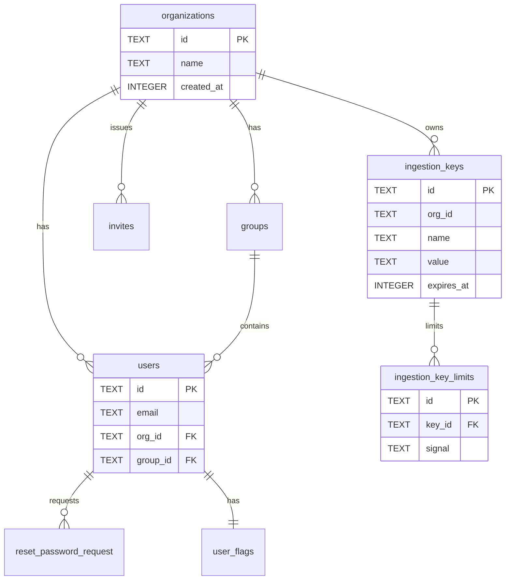

# SigNoz — Data Schema (summary)

Two planes, no Liquibase: metadata in SQLite (default) / Postgres driven by 135
Go migrations in `pkg/sqlmigration` (000–135); telemetry in ClickHouse read
through `pkg/telemetryschema` constants.

## Metadata ERD

## Tables at a glance

| Domain | Tables | Notes |
|--------|--------|-------|
| Identity/org | `organizations`, `users`, `groups`, `invites`, `org_domains`, `user_flags`, `user_preference`, `org_preference` | `users` has a unique (`email`,`org_id`) index (065) |
| Auth | `factor_password`, `factor_api_key`, `reset_password_request`, `reset_password_token`, `role`, `service_account`, `personal_access_token` | role column on `users` dropped in 072 |
| Authz tuples | authz tables plus `*_tuples` additions | permission data parallels the OpenFGA provider |
| Dashboards | `dashboards`, `saved_views`, `dashboard_view`, `integration_dashboard` | JSON `data` column, soft `locked` flag |
| Alerting | `rules`, `rule_history`, `planned_maintenance`, `notification_channels`, `alertmanager_config`, `alertmanager_state`, `ttl_setting` | `deleted` soft-delete on rules/channels |
| Pipelines/integrations | `pipelines`, `integrations_installed`, `cloud_integration*`, `agents`, `agent_config_*` | |
| Ingestion | `ingestion_keys`, `ingestion_key_limits` | fork addition (135); legacy table dropped in 016 |
| Misc | `quick_filter`, `trace_funnel`, `virtual_field`, `apdex_settings`, `tag`, `tag_relation`, `llm_pricing_rules` | |

71 distinct table names appear across migration history; `groups` (029),
`licenses`/`sites` (018) and other deprecated tables (040) were dropped.

## ClickHouse

| Database | Main distributed tables |
|----------|------------------------|
| `signoz_traces` | `distributed_signoz_index_v3`, `distributed_traces_v3_resource`, `distributed_tag_attributes_v2`, `distributed_top_level_operations`, `distributed_trace_summary` |
| `signoz_logs` | `distributed_logs_v2`, `distributed_logs_v2_resource`, `distributed_logs_attribute_keys`, `distributed_logs_resource_keys` |
| `signoz_metrics` | `distributed_samples_v4` (+ `_agg_5m`, `_agg_30m`), `distributed_time_series_v4`, `distributed_exp_hist`, `distributed_updated_metadata` |
| `signoz_meter` | `distributed_samples`, `distributed_samples_agg_1d` |

ClickHouse DDL is owned outside these migrations (collector/operator).

## Other schema kinds

- **Config**: `conf/example.yaml`, 27 top-level sections mapping to Go `Config`
  structs; `conf/plugins.example.yaml` (`dir`, `enabled`).
- **Data files**: `plugins/manifest.json` (`plugins[]` with id, version, element,
  source, bundlePath), `plugins/<id>/<version>/plugin.js`, `tests/fixtures/`.
- **Interfaces**: `docs/api/openapi.yml` (generated, feeds orval),
  `/api/v1/plugins*` routes, `sqlgateway` ingestion-key CRUD.
