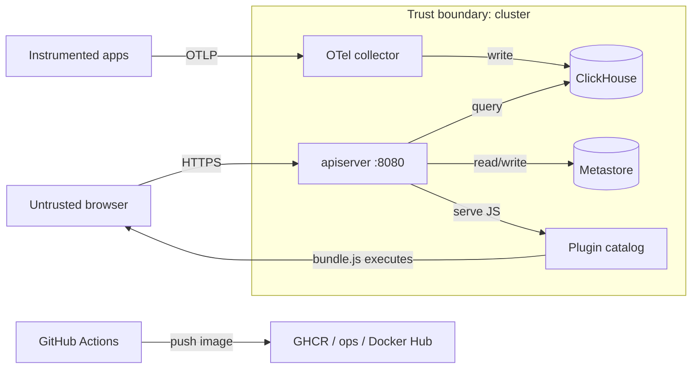

# SigNoz — Threat Model

## Overview

The crown jewels are **telemetry data** (traces, logs, metrics — potentially
containing customer payloads), **identity and authorization data** in the
metastore, and **ingestion keys**, which are bearer credentials for writing
telemetry. The deployed perimeter is a single container image serving the API
and UI on one HTTP port, backed by a relational metastore and a ClickHouse
cluster that is written by a separate OTel collector.

Trust boundaries that matter: the public internet ↔ the UI/API listener;
instrumented applications ↔ the collector; the backend process ↔ the metastore
and ClickHouse (credentialed config); the plugin catalog ↔ the browser (JS
execution inside a dashboard); and CI ↔ the container registries it publishes to.
The fork removes licensing and hosted-service integration, so those callbacks and
endpoints are not part of the surface.

## Attack surface

→ *See [PROJ-ARCH.md](PROJ-ARCH.md) for the component view and [PROJ-LAYOUT.md](PROJ-LAYOUT.md) for where each control lives*

## Vulnerability register

| ID | Severity | STRIDE | Component | Status |
|----|----------|--------|-----------|--------|
| T-001 | High | Tampering / Elevation | Dashboard panel could load arbitrary script | Mitigated (catalog allowlist; panel JSON carries `pluginId`, never a URL) |
| T-002 | Medium | Information disclosure | Ingestion keys stored plaintext (`ingestion_keys.value`) and returned in full by list/get | Open |
| T-003 | Medium | Elevation | Operator-supplied `bundlePath` in `manifest.json` is not constrained server-side | Partial (serving path is contained; frontend validates) |
| T-004 | Medium | Elevation | Impersonation resolver trusts request headers | Mitigated (disabled by default; mutually exclusive with tokenizer/apikey) |
| T-005 | Medium | Spoofing | Caller identity comes from request headers (`Authorization`, `SIGNOZ-API-KEY`) | Partial (deployment must front the API with a trusted proxy) |
| T-006 | Low | Information disclosure | Images pushed to public registries by CI | Partial (GHCR public; other registries skipped without creds) |
| T-007 | Low | Denial of service | Long-lived routes excluded from the request timeout | Partial (`/api/v1/logs/tail`, `/api/v3/logs/livetail`, `/api/v1/export_raw_data`) |
| T-008 | Medium | Tampering | User-supplied filters flow into ClickHouse SQL | Partial (parameterized args via `querybuilder`/`statementbuilder`; grammar-validated) |
| T-009 | Low | Repudiation | Mutation attribution depends on audit coverage | Partial (`auditor` events on mutating paths) |

## Controls worth naming

- **Authorization is tuple-based**: every route is wrapped by `AuthZ`
  (`ViewAccess`/`EditAccess`/`AdminAccess`/`OpenAccess`) and the default provider
  is OpenFGA; denials are explicit (`::AUTHZ-DENIED::`), not silent.
- **Cross-org isolation**: `identn` rejects identity claims that do not belong to
  the resolved organization (`::IDENTITY-CROSS-ORG::`).
- **Plugin containment**: bundle ids and versions must match
  `^[a-z0-9][a-z0-9._-]{0,63}$`, and served files are resolved and checked to stay
  inside the catalog directory (`path escapes plugin directory`).
- **No license surface**: the licensing provider is a noop, so no license
  validation callback or key material exists to attack.

## Mitigation coverage

2 mitigated (T-001, T-004) · 1 open (T-002) · 6 partial (T-003, T-005–T-009).
The open item is a design property of the ingestion-key model, not a bug: callers
with read access to keys can retrieve them, which is also how they are copied
into collector configuration.

## Residual risk

- Ingestion keys are long-lived bearer tokens; rotation is a delete-and-recreate,
  with `expires_at` as the only automatic expiry.
- Telemetry content is only as protected as the ClickHouse and metastore
  credentials in the YAML config; there is no application-level field encryption.
- The plugin allowlist is enforced primarily in the frontend loader; a compromised
  catalog directory is equivalent to arbitrary script delivery to dashboards.
- Header-derived identity is safe only when the API is not directly
  internet-reachable — the deployment must guarantee that.

→ *See [PROJ-SCHEMA.md](PROJ-SCHEMA.md) for the stores named above*
